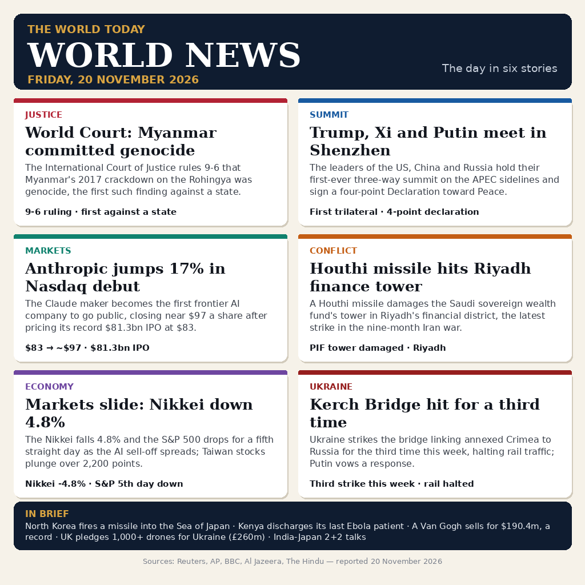

# 20 November 2026 — World News in One Image

[](https://make.fun/bounty/news-image-20261120/leaderboard?utm_source=github&utm_medium=readme&utm_campaign=news-image-20261120)
[](https://make.fun/bounty/news-image-20261120?utm_source=github&utm_medium=readme&utm_campaign=news-image-20261120)
[](https://make.fun/bounty/news-image-20261120?utm_source=github&utm_medium=readme&utm_campaign=news-image-20261120)

One 1024&times;1024 infographic summing up the world news of **20 November 2026**,
built for the [make.fun news-image-20261120 competition](https://make.fun/bounty/news-image-20261120?utm_source=github&utm_medium=readme&utm_campaign=news-image-20261120)
($250 pot, top 50 paid).

The layout leads with the six biggest stories of the day — a historic court
ruling, a first-ever trilateral summit, a record AI IPO, a missile strike on
Riyadh, a global market sell-off and another Kerch Bridge strike — and closes
with an **IN BRIEF** strip of the day's other headlines. Every story below was
checked against same-day reporting before it was drawn, including the ICJ vote
(9-6), the Anthropic close (~$97 vs an $83 offer) and the Nikkei drop (4.8%).



## The six stories

1. **World Court: Myanmar committed genocide.** The International Court of
   Justice rules 9-6 that Myanmar's 2017 crackdown on the Rohingya was
   genocide — the first such finding against a state.
2. **Trump, Xi and Putin meet in Shenzhen.** The leaders of the US, China and
   Russia hold their first-ever three-way summit on the APEC sidelines and
   sign a four-point Declaration toward Peace.
3. **Anthropic jumps 17% in Nasdaq debut.** The Claude maker becomes the first
   frontier AI company to go public, closing near $97 a share after pricing
   its record $81.3bn IPO at $83.
4. **Houthi missile hits Riyadh finance tower.** A Houthi missile damages the
   Saudi sovereign wealth fund's tower in Riyadh's financial district, the
   latest strike in the nine-month Iran war.
5. **Markets slide: Nikkei down 4.8%.** The Nikkei falls 4.8% and the S&P 500
   drops for a fifth straight day as the AI sell-off spreads; Taiwan stocks
   plunge over 2,200 points.
6. **Kerch Bridge hit for a third time.** Ukraine strikes the bridge linking
   annexed Crimea to Russia for the third time this week, halting rail
   traffic; Putin vows a response.

The image also carries an **IN BRIEF** strip with the day's other headlines:
North Korea's missile launch, Kenya's last Ebola patient, a record Van Gogh
sale, the UK's drone pledge for Ukraine, and India-Japan 2+2 talks.

## How it works

`main.py` copies `assets/entry.png` to `/output/entry.png` and verifies the copy
byte-for-byte with SHA-256, so the output is deterministic:

```bash
python3 main.py
# copied assets/entry.png -> /output/entry.png
# sha256: <digest of the image>
```

No network access is needed at run time. Python 3 only, standard library only.

## Preview

Open `index.html` in a browser to see the image together with the story list.
